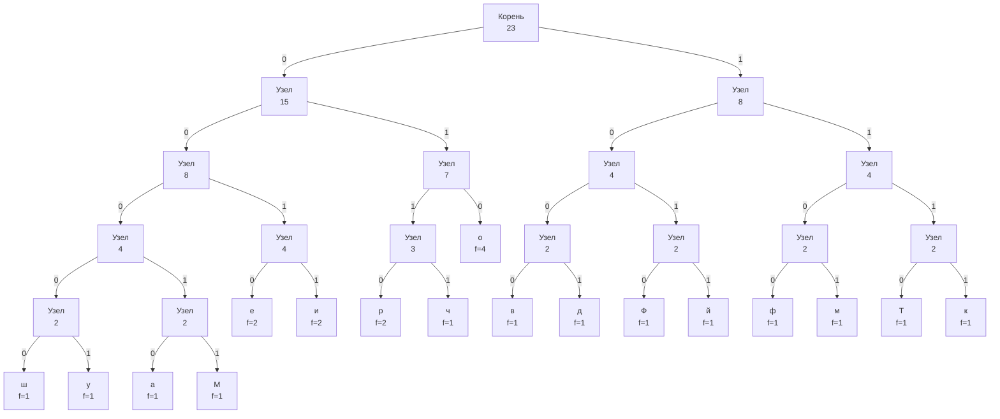

# Лабораторная работа № 9. Кодирование ФИО методом Хаффмана

## 1. Условие и исходное сообщение

Кодируется строка без пробелов и знаков препинания:

```text
МарушкоТимофейФедорович
```

В сообщении $n=23$ символа. Учитываются регистр и вид буквы: например, «М» и «м», «Ф» и «ф» являются разными символами. Частоты подсчитаны динамически по самому сообщению, как допускает практическое задание лабораторной работы № 9.

> По практикуму это лабораторная работа № 9 «Сжатие/распаковка данных на основе статистических методов», а лабораторная № 8 в этом репозитории посвящена преобразованию Барроуза – Уилера. См. практикум, ч. 1, с. 84–93; описание ЛР8 и ЛР9 в соответствующих README.

## 2. Частоты и вероятности символов

Частота символа $f_i$ – число его появлений в сообщении. Вероятность оценивается как $p_i=f_i/n$.

| Символ | Частота $f_i$ | Вероятность $p_i=f_i/23$ |
|---|---:|---:|
| о | 4 | $4/23\approx0{,}1739$ |
| е | 2 | $2/23\approx0{,}0870$ |
| и | 2 | $2/23\approx0{,}0870$ |
| р | 2 | $2/23\approx0{,}0870$ |
| а | 1 | $1/23\approx0{,}0435$ |
| в | 1 | $1/23\approx0{,}0435$ |
| д | 1 | $1/23\approx0{,}0435$ |
| й | 1 | $1/23\approx0{,}0435$ |
| к | 1 | $1/23\approx0{,}0435$ |
| м | 1 | $1/23\approx0{,}0435$ |
| М | 1 | $1/23\approx0{,}0435$ |
| Т | 1 | $1/23\approx0{,}0435$ |
| у | 1 | $1/23\approx0{,}0435$ |
| ф | 1 | $1/23\approx0{,}0435$ |
| Ф | 1 | $1/23\approx0{,}0435$ |
| ч | 1 | $1/23\approx0{,}0435$ |
| ш | 1 | $1/23\approx0{,}0435$ |
| **Итого** | **23** | **1** |

## 3. Построение дерева Хаффмана

По алгоритму из практикума два символа или узла с наименьшими вероятностями объединяются в новый узел. Вероятность нового узла равна сумме вероятностей потомков. Операция повторяется, пока не останется один корень. Код символа – последовательность меток ветвей от корня до соответствующего листа.

Для однозначной таблицы при равных частотах зафиксирован следующий порядок выбора: символы рассматриваются в порядке первого появления в строке; вновь созданный узел ставится после уже имеющихся узлов с той же частотой. В каждой паре левому потомку назначена ветвь «1», правому – «0». При другом разрешении равенств коды могут отличаться, но оставаться корректными и давать ту же суммарную длину.

| Шаг | Объединяемые узлы (частоты) | Новый узел |
|---:|---|---:|
| 1 | М (1) + а (1) | (Ма) (2) |
| 2 | у (1) + ш (1) | (уш) (2) |
| 3 | к (1) + Т (1) | (кТ) (2) |
| 4 | м (1) + ф (1) | (мф) (2) |
| 5 | й (1) + Ф (1) | (йФ) (2) |
| 6 | д (1) + в (1) | (дв) (2) |
| 7 | ч (1) + р (2) | (чр) (3) |
| 8 | и (2) + е (2) | (ие) (4) |
| 9 | (Ма) (2) + (уш) (2) | ((Ма)(уш)) (4) |
| 10 | (кТ) (2) + (мф) (2) | ((кТ)(мф)) (4) |
| 11 | (йФ) (2) + (дв) (2) | ((йФ)(дв)) (4) |
| 12 | (чр) (3) + о (4) | ((чр)о) (7) |
| 13 | (ие) (4) + ((Ма)(уш)) (4) | узел (8) |
| 14 | ((кТ)(мф)) (4) + ((йФ)(дв)) (4) | узел (8) |
| 15 | узел (7) + узел (8) | узел (15) |
| 16 | узел (8) + узел (15) | корень (23) |

Полное дерево Хаффмана показано ниже. Метка на стрелке – бит перехода: `1` или `0`. Внутреннее число – суммарная частота листьев под узлом, а в листе указаны символ и его частота. Путь от корня до листа даёт код символа.



Например, путь `0 → 1 → 1 → 1` приводит к листу «ч», поэтому его код – `0111`. Полные коды приведены в таблице ниже.

## 4. Таблица кодирования

| Символ | Частота | Код Хаффмана | Длина кода $l_i$ |
|---|---:|---:|---:|
| о | 4 | 010 | 3 |
| е | 2 | 0010 | 4 |
| и | 2 | 0011 | 4 |
| р | 2 | 0110 | 4 |
| а | 1 | 00010 | 5 |
| в | 1 | 1000 | 4 |
| д | 1 | 1001 | 4 |
| й | 1 | 1011 | 4 |
| к | 1 | 1111 | 4 |
| м | 1 | 1101 | 4 |
| М | 1 | 00011 | 5 |
| Т | 1 | 1110 | 4 |
| у | 1 | 00001 | 5 |
| ф | 1 | 1100 | 4 |
| Ф | 1 | 1010 | 4 |
| ч | 1 | 0111 | 4 |
| ш | 1 | 00000 | 5 |

Коды различны, и ни один код не является началом другого. Следовательно, таблица является префиксной и допускает однозначное декодирование.

## 5. Сжатие

Каждый знак исходного сообщения заменяется кодом из таблицы:

```text
М       а      р     у      ш      к     о    Т     и     м
00011  00010  0110  00001  00000  1111  010  1110  0011  1101

о    ф     е     й     Ф     е     д     о    р     о    в     и     ч
010  1100  0010  1011  1010  0010  1001  010  0110  010  1000  0011  0111
```

Сжатая битовая последовательность:

```text
00011000100110000010000011110101110001111010101100001010111010001010010100110010100000110111
```

Её длина $V_{пс}=92$ бита. Проверка по таблице частот: $\sum_i f_i l_i=92$.

## 6. Распаковка

Распаковщик читает биты слева направо и проходит по дереву: бит 1 выбирает левую ветвь, бит 0 – правую. При достижении листа выводится соответствующий символ, затем поиск продолжается от корня.

Например, начальные биты `00011` ведут к листу «М». Следующие биты `00010` дают «а», затем `0110` – «р», `00001` – «у». Продолжая разбор всей последовательности, получаем:

```text
МарушкоТимофейФедорович
```

Восстановленная строка совпадает с исходной, поэтому преобразование выполнено без потерь.

## 7. Оценка эффективности

Для сравнения принимается 8 бит на символ, как в приведённом в практикуме сравнении с кодами ASCII. Тогда объём исходного сообщения:

$$V_{дс}=23\cdot 8=184\text{ бита}.$$

В практикуме заданы отношения:

$$R_1=\frac{V_{пс}}{V_{дс}}\cdot100\%,\qquad
R_2=\frac{V_{дс}-V_{пс}}{V_{дс}}\cdot100\%=(1-R_1/100\%)\cdot100\%.$$

Подстановка значений:

$$R_1=\frac{92}{184}\cdot100\%=50\%,$$

$$R_2=\frac{184-92}{184}\cdot100\%=50\%.$$

$R_1$ показывает, какую долю исходного объёма занимает закодированное сообщение; $R_2$ показывает сокращение объёма. Упаковка служебной информации (таблицы кодов/дерева и длины сообщения) здесь не учитывается, так как сравниваются только битовые последовательности по формулам практикума.

Интегральный коэффициент средней длины кода из практикума:

$$C=\sum_i p_i l_i=\frac{\sum_i f_i l_i}{n}=\frac{92}{23}=4\text{ бита/символ}.$$

Итог: при сравнении с 8 битами на символ средняя длина уменьшилась до 4 бит/символ; объём этой строки кодированием Хаффмана сокращён на 50% без потери данных.

## 8. Вывод

Для строки «МарушкоТимофейФедорович» подсчитаны частоты 17 различных символов, построено дерево Хаффмана и составлена префиксная таблица кодов. Исходные 23 символа закодированы в 92 бита и затем восстановлены без ошибок. Получены $R_1=50\%$, $R_2=50\%$ и $C=4$ бита на символ.

## Источник

- Лабораторный практикум по дисциплинам «Защита информации и надежность информационных систем» и «Криптографические методы защиты информации». Ч. 1. Кодирование информации. БГТУ, 2019. Лабораторная работа № 9, разделы 9.1.3–9.2, с. 90–93; формулы $R_1$, $R_2$ – с. 76.
